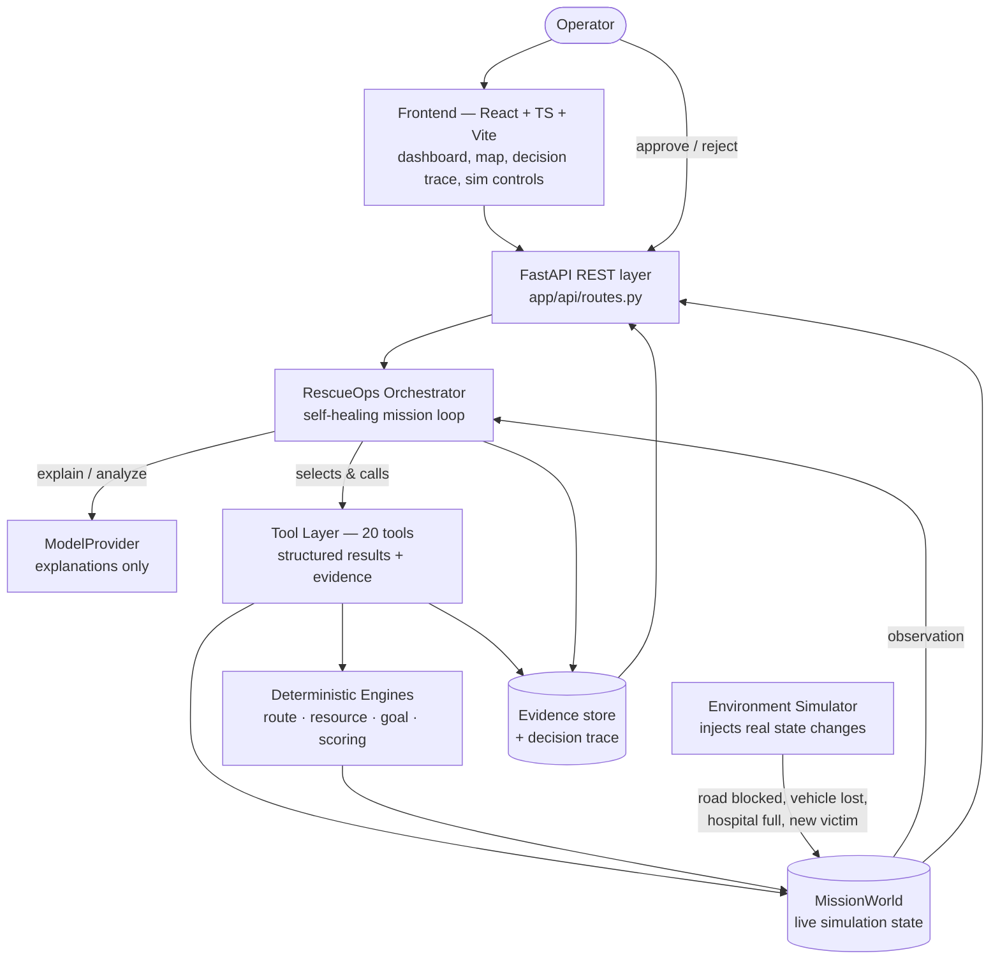
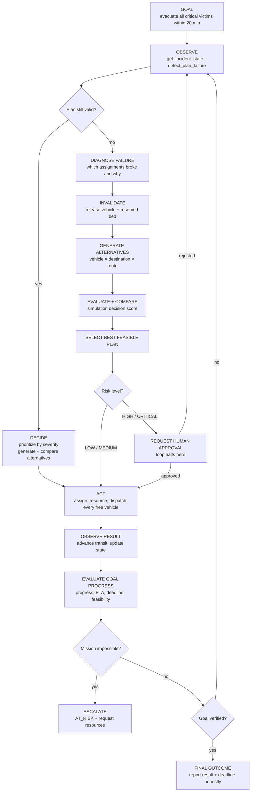
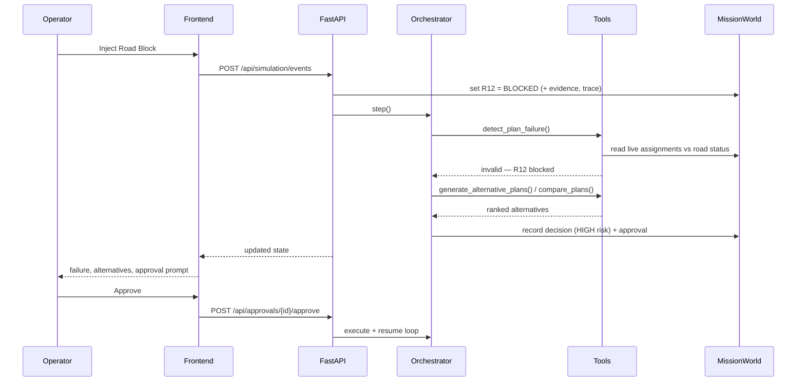

# RescueOps AI — Architecture

> **Scope note.** RescueOps is a *simulation and decision-support prototype*. It does not
> connect to, and must not be connected to, real emergency infrastructure or dispatch systems.

---

## 1. System overview

The important structural claim: **the agent never reads its own plan as ground truth.**
Every iteration re-reads `MissionWorld`, which the environment simulator can mutate at any
moment. That is what makes the adaptation real rather than scripted.

---

## 2. The self-healing mission loop

Implemented in [`backend/app/agents/orchestrator.py`](../backend/app/agents/orchestrator.py)
(`step()` = exactly one iteration).

**Termination.** Each mission carries `max_iterations` (default 60) and `run_until_blocked`
caps steps per call. The loop exits on goal verification, iteration limit, or a pending
approval. There is no unbounded loop anywhere.

---

## 3. Division of labour: LLM vs. deterministic code

This is the core design decision of the project.

| Concern | Handled by | Why |
|---|---|---|
| Shortest / lowest-cost route | NetworkX (`route_engine`) | Must be correct and reproducible |
| Alternative route generation | `nx.shortest_simple_paths` | Genuinely distinct ranked options |
| ETA, distance, risk aggregation | `route_engine` | Arithmetic, not judgement |
| Vehicle & hospital capacity | `resource_engine` | Hard constraints must never be hallucinated |
| Victim prioritization | severity ordering | Deterministic and auditable |
| Decision / mission scoring | `scoring.py` | Transparent, inspectable weights |
| Goal progress & feasibility | `goal_engine` | Drives the mission verdict |
| Plan failure detection | `tools.detect_plan_failure` | Must be exact |
| Explaining a decision | **ModelProvider (LLM)** | Natural language for the operator |
| Summarizing a failure | **ModelProvider (LLM)** | Narrative synthesis |
| Interpreting the goal | **ModelProvider (LLM)** | Language understanding |

An LLM outage therefore degrades *explanations*, never *correctness*: `AnthropicProvider`
falls back to `LocalFallbackProvider` on timeout, HTTP error, or malformed JSON.

---

## 4. State model

`MissionWorld` ([`app/models/domain.py`](../backend/app/models/domain.py)) is the single
source of truth for a mission:

| Field | Contents |
|---|---|
| `mission` | status, agent state, elapsed/progress/ETA, iteration counters |
| `goal` | objective, deadline, priority, constraints, success conditions |
| `zones` / `roads` | road network graph with per-road status and risk |
| `victims` | severity, headcount, medical + destination requirement, status, assignee |
| `vehicles` | type, location, capacity, status, capabilities, current assignment |
| `hospitals` / `shelters` | capacity vs. live occupancy, capabilities |
| `current_plan` | victim → {resource, destination, road_ids, ETA, start time} |
| `decisions` | every decision with alternatives, risk, confidence, evidence |
| `evidence` | append-only observation/action log |
| `trace` | human-readable timeline |
| `approvals` / `pending_action` | human-in-the-loop gate |
| `metrics` | replans, route changes, successes/failures, escalations |

---

## 5. Failure recovery — worked example (the demo)

| Stage | What actually happens in state |
|---|---|
| **OLD PLAN** | `AMB-A → V-0001 (CRITICAL, Zone A) → Hospital H1` over road **R12**, ETA ~5.8 min, score 87.5 |
| **CHANGE** | `POST /api/simulation/events {ROAD_BLOCKED, R12}` sets `roads["R12"].status = BLOCKED` |
| **DETECT** | `detect_plan_failure` finds R12 inside a live assignment's `road_ids` → plan invalid |
| **IMPACT** | Affected assignments invalidated; vehicle and reserved hospital bed returned to the pool |
| **ALTERNATIVES** | `generate_alternative_plans` builds vehicle × destination × route options; blocked edges are absent from the graph, so R12 cannot reappear |
| **COMPARE** | Ranked by simulation decision score (deadline, priority, risk, response time) |
| **NEW PLAN** | `Reassign AMB-A → V-0001 → Hospital H2` — destination change for a CRITICAL victim ⇒ **HIGH risk** |
| **GATE** | Loop halts; operator sees the proposal with alternatives and evidence |
| **RESULT** | On approval the plan executes; mission resumes and verifies the goal |

---

## 6. Risk boundaries (human-in-the-loop)

| Risk | Condition | Agent behaviour |
|---|---|---|
| LOW | Fresh assignment, no failure | Executes automatically |
| MEDIUM | Replan that keeps the same destination | Executes, records full reasoning |
| HIGH | Replan that **changes destination for a CRITICAL victim** | **Halts for human approval** |
| CRITICAL | Mission detected infeasible | Escalates, recommends additional resources |

While `pending_action` is set, `step()` returns `WAITING_APPROVAL` and performs no actions.

---

## 7. Request flow (agent step)

---

## 8. Known architectural limitations

- **State lives in process memory** (`app/services/store.py`). Restarting the backend clears
  missions; it is single-worker by design. A DB/Redis-backed store is the scale-out path.
- **Time is discrete**, advanced in fixed simulated steps rather than continuously.
- **Vehicles carry one victim group per trip**; capacity is checked but not packed.
- **The road graph is small and synthetic** (7 nodes, 15 roads), not real map data.
- **The decision score is a transparent heuristic**, not a validated emergency metric.
